 # labo 1 : Continuous Integration/Deployment met Jenkins
 **Student:** Senne Coppens

In dit labo bouw ik met Jenkins een CI/CD-pipeline die een applicatie ophaalt uit een Git-repository, bouwt, test en opnieuw deployt. Daarna breid ik de omgeving uit met twee .NET-applicaties, MariaDB, automatische deployments, Ansible en een lokale GitLab-server.
## Checklist beoordeling
 
- [x] GitHub-repo sample app en .Net-app getoond
- [x] Beide apps draaien in de browser
- [x] Jenkins-dashboard met alle jobs
- [x] Wijziging gemaakt, gecommit en gepusht
- [x] Pipeline gestart en wijziging zichtbaar in de browser
- [x] Je kunt je setup uitleggen
- [x] Verslag en cheat sheet met screenshots en console-output


## Inhoud
 
1. [Wachtwoorden en omgeving](#1-wachtwoorden-en-omgeving)
2. [Repository sample app](#2-repository-sample-app)
3. [Jenkins starten en configureren](#3-jenkins-starten-en-configureren)
4. [BuildSampleApp](#4-buildsampleapp)
5. [TestSampleApp](#5-testsampleapp)
6. [Pipeline](#6-pipeline)
7. [Jenkinsfile](#7-jenkinsfile)
8. [Wijziging doorvoeren](#8-wijziging-doorvoeren)
9. [.Net-applicatie](#9-net-applicatie)
10. [Overzicht Jenkins-dashboard](#10-overzicht-jenkins-dashboard)
11. [Cheat sheet](#11-cheat-sheet)
12. [Uitbreiding: RISE-app op MariaDB](#12-uitbreiding-rise-app-op-mariadb)
13. [Uitbreiding: automatisch deployen bij een push](#13-uitbreiding-automatisch-deployen-bij-een-push)
14. [Uitbreiding: Jenkins persistent met Ansible](#14-uitbreiding-jenkins-persistent-met-ansible)
15. [Uitbreiding: lokale Git-server met GitLab](#15-uitbreiding-lokale-git-server-met-gitlab)
16. [Wat ik geleerd heb](#16-wat-ik-geleerd-heb)

---


## Wachtwoorden en omgeving
| User/account | Password |
| ------------ | -------- |
| admin | Administrator2026! |
| Jenkins (initieel wachtwoord) | 25d61ea929f34276bf3ab86858daefe2 |

| Onderdeel | Waarde |
| --------- | ------ |
| Jenkins | http://172.16.0.10:8080/ |
| Portainer | http://172.16.0.10:9000/ |
| Sample app | http://172.16.0.10:5050/ |
| Todo-app (.Net) | http://172.16.0.10:8081/ |
| RISE-app (.Net) | http://172.16.0.10:8082/ |
| GitLab | http://172.16.0.10:8929/ |

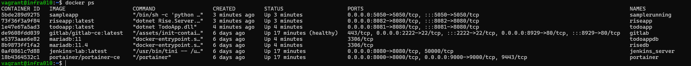


## 2. Repository sample app

De starter code staat in een map buiten de cursus-repo en is gepusht naar GitHub:
https://github.com/CoppensSenne/cicd-sample-app

```bash
cd ~/cicd-sample-app
git init
git add .
git commit -m "Initial commit of sample application"
git branch -M main
git remote add origin git@github.com:CoppensSenne/cicd-sample-app.git
git push -u origin main
```

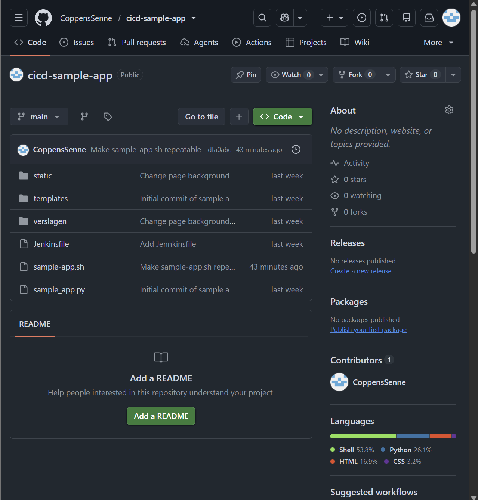

## 3. Jenkins starten en configureren

Image downloaden en starten:

```bash
docker pull jenkins/jenkins:lts

docker run -p 8080:8080 -u root \
  -v jenkins-data:/var/jenkins_home \
  -v $(which docker):/usr/bin/docker \
  -v /var/run/docker.sock:/var/run/docker.sock \
  -v "$HOME":/home \
  --name jenkins_server jenkins/jenkins:lts
```

Bestaat de container al: `docker start jenkins_server`.

| Optie | Betekenis |
| ----- | --------- |
| `-p 8080:8080` | Poort 8080 van de container is bereikbaar op poort 8080 van de VM |
| `-u root` | De container draait als root, nodig voor Docker-toegang |
| `-v jenkins-data:/var/jenkins_home` | Bewaart de Jenkins-gegevens in een volume |
| `-v $(which docker)` en `-v /var/run/docker.sock` | Geeft Jenkins het `docker`-commando en toegang tot de Docker-daemon van de VM |
| `--name jenkins_server` | Vaste naam voor de container |

Doordat de Docker-socket gemount is, start Jenkins containers op de host. De sample app draait dus naast Jenkins en niet erin.

Configuratie in de browser (http://172.16.0.10:8080/):

1. Opstartwachtwoord invoeren
2. **Install suggested plugins**
3. **Skip and continue as admin**
4. **Save and Finish**, dan **Start using Jenkins**

## Stap 1.4: Jenkins configureren

Browser: <http://172.16.0.10:8080/>

1. Opstartwachtwoord invoeren.
2. **Install suggested plugins**.
3. **Skip and continue as admin**. De gebruiker is dus `admin`, met het opstartwachtwoord.
4. **Save and Finish**, daarna **Start using Jenkins**.


## 4. BuildSampleApp

Freestyle project:

- Git URL: `https://github.com/CoppensSenne/cicd-sample-app.git`
- Branch: `*/main`
- Build step (Execute shell): `bash ./sample-app.sh`

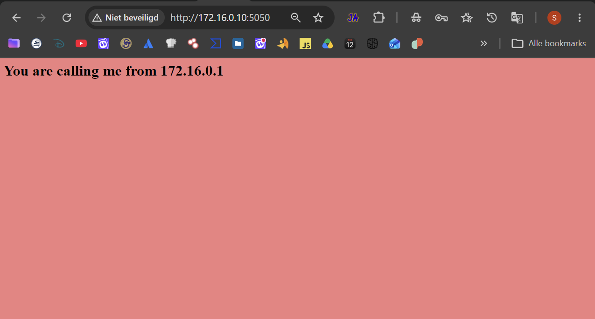

### Fout 1: tempdir bestaat al

```
mkdir: cannot create directory 'tempdir': File exists
```

Oorzaak: de workspace wordt niet opgeruimd, dus `tempdir` bestaat nog van de vorige build.

Oplossing (eenmalig):

```bash
docker exec jenkins_server rm -rf /var/jenkins_home/workspace/BuildSampleApp/tempdir
```

### Fout 2: containernaam bestaat al

```
docker: Error response from daemon: Conflict. The container name "/samplerunning" is already in use
```

Oorzaak: `samplerunning` draait nog van de vorige build.

Oplossing (eenmalig):

```bash
docker stop samplerunning
docker rm samplerunning
```

### Blijvende oplossing in sample-app.sh

```bash
rm -rf tempdir
mkdir tempdir
...
docker stop samplerunning || true
docker rm samplerunning || true
```

Zo werkt het script bij elke build (idempotent). Pushen naar GitHub is nodig, want Jenkins haalt de code daar op.

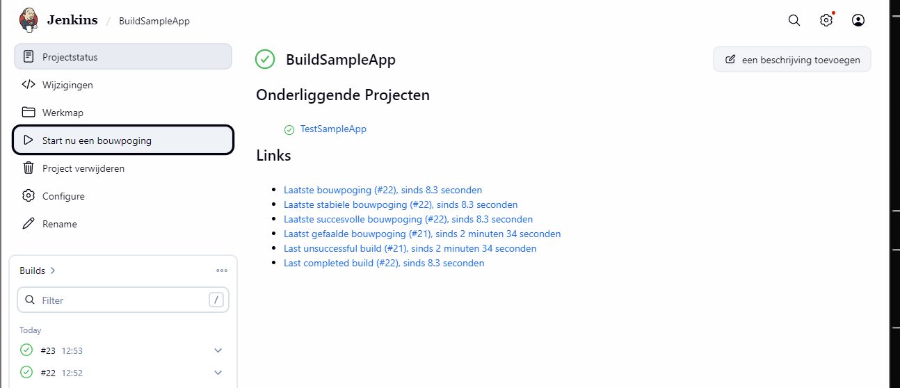
## 5. TestSampleApp

IP's opzoeken:

```bash
docker inspect -f '{{range.NetworkSettings.Networks}}{{.IPAddress}}{{end}}' samplerunning
docker inspect -f '{{range.NetworkSettings.Networks}}{{.IPAddress}}{{end}}' jenkins_server
```

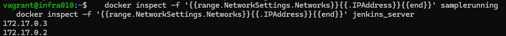

Freestyle project:

- Trigger: *Build after other projects are built* met `BuildSampleApp`
- Build step:

```bash
curl http://172.16.0.10:5050/ | grep "You are calling me from 172.16.0.1"
```
```bash
vagrant@infra010:~$ curl http://172.16.0.10:5050/ | grep "You are calling me from 172.16.0.1"
  % Total    % Received % Xferd  Average Speed   Time    Time     Time  Current
                                 Dload  Upload   Total   Spent    Left  Speed
100   178  100   178    0     0  29460      0 --:--:-- --:--:-- --:--:-- 29666
    <h1>You are calling me from 172.16.0.10</h1>
vagrant@infra010:~$ echo $?
0
vagrant@infra010:~$
```

`grep` geeft exit code 0 bij een match (job slaagt) en 1 zonder match (job faalt).

📸 Configuratie en geslaagde run van `TestSampleApp`

## 6. Pipeline

Pipeline-job `SampleAppPipeline`:

```groovy
node {
    stage('Preparation') {
        catchError(buildResult: 'SUCCESS') {
            sh 'docker stop samplerunning'
            sh 'docker rm samplerunning'
        }
    }
    stage('Build') {
        build 'BuildSampleApp'
    }
    stage('Results') {
        build 'TestSampleApp'
    }
}
```

Stages: oude container opruimen, bouwen, testen.

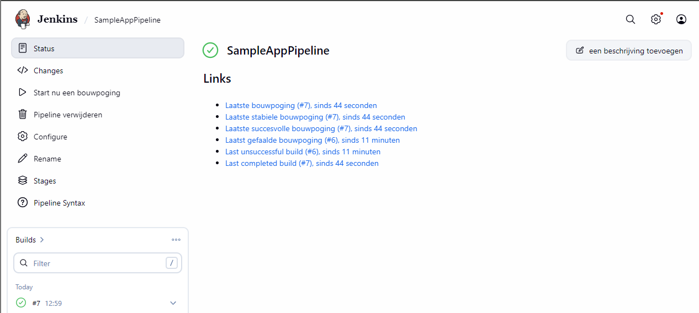


## 7. Jenkinsfile

Dezelfde code in een bestand `Jenkinsfile` in de root van de repo. De oude pipeline is verwijderd en een nieuwe gemaakt met *Pipeline script from SCM*.

```bash
git add Jenkinsfile
git commit -m "Add Jenkinsfile"
git push origin main
```

Voordeel: de pipeline staat als code in Git bij de applicatie.


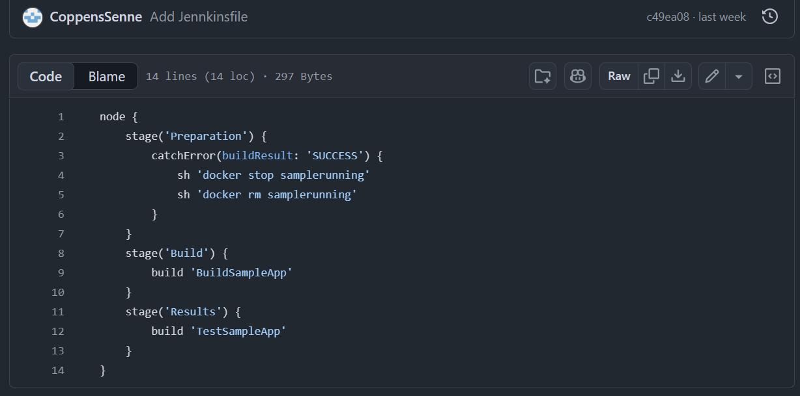

## 8. Wijziging doorvoeren

`static/style.css`: achtergrondkleur van `lightsteelblue` naar `lightcoral`.

```bash
git add .
git commit -m "Change background color"
git push origin main
```

Pipeline gestart en de browser herladen.

📸 De app voor en na de wijziging

## 9. .Net-applicatie

Todo-app met MariaDB. Fork: https://github.com/CoppensSenne/dotnet-demo-app

Wat ik uit de repo haalde:

- Twee containers: database (`todoappdb`, `mariadb:11`) en webapp (`todoapp`).
- De app luistert op 8080, maar dat is Jenkins. Daarom publiceer ik op **8081**.
- Jenkins heeft geen `docker compose`, dus gewone `docker`-commando's in het Jenkinsfile.

Jenkinsfile (root van de fork):

```groovy
node {
    stage('Checkout') {
        checkout scm
    }
    stage('Preparation') {
        sh 'docker network create todo-net || true'
        sh 'docker network connect todo-net jenkins_server || true'
        sh 'docker stop todoapp || true'
        sh 'docker rm todoapp || true'
    }
    stage('Database') {
        sh '''
        if [ -z "$(docker ps -aq -f name=^todoappdb$)" ]; then
          docker run -d --name todoappdb --network todo-net \
            -e MARIADB_ROOT_PASSWORD=sekrit \
            -e MARIADB_DATABASE=todo_db \
            -e MARIADB_USER=todo_usr \
            -e MARIADB_PASSWORD=letmeinplz \
            -v todoapp-db-data:/var/lib/mysql \
            mariadb:11
        else
          docker start todoappdb || true
        fi
        for i in $(seq 1 30); do
          docker exec todoappdb healthcheck.sh --connect --innodb_initialized && break
          sleep 2
        done
        docker exec -i todoappdb mariadb -utodo_usr -pletmeinplz todo_db < TodoApp/schema.sql || true
        '''
    }
    stage('Build') {
        sh 'docker build -t todoapp:latest TodoApp'
    }
    stage('Deploy') {
        sh '''
        docker run -d --name todoapp --network todo-net -p 8081:8080 \
          -e "ConnectionStrings__TodoDb=Server=todoappdb;Port=3306;Database=todo_db;User=todo_usr;Password=letmeinplz;" \
          -e ASPNETCORE_ENVIRONMENT=Development \
          todoapp:latest
        '''
    }
    stage('Test') {
        sh '''
        for i in $(seq 1 20); do
          curl -sf http://todoapp:8080/ > /dev/null && echo "App OK" && exit 0
          sleep 3
        done
        echo "App reageert niet"
        exit 1
        '''
    }
}
```

Uitleg:

- Eigen netwerk `todo-net`: app en database vinden elkaar via de naam `todoappdb`.
- Jenkins zit ook op dat netwerk, zodat de test `http://todoapp:8080/` kan bereiken.
- De database heeft een volume, dus todo's blijven bestaan. Enkel de app wordt vervangen.
- Het .NET-SDK staat niet in Jenkins; `docker build` bouwt de app.

Jenkins: Pipeline `TodoAppPipeline`, *Pipeline script from SCM*, URL van de fork, `*/main`, `Jenkinsfile`.

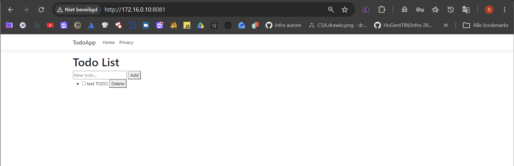

📸 `docker ps` met `todoapp` en `todoappdb`, en de app in de browser op poort 8081

## 10. Overzicht Jenkins-dashboard

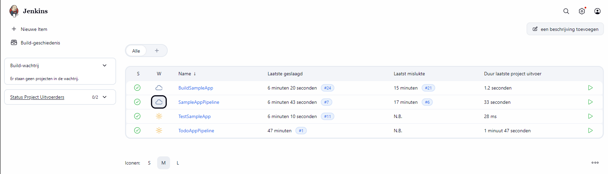

## 11. Cheat sheet

| Doel | Commando |
| ---- | -------- |
| Containers bekijken | `docker ps` / `docker ps -a` |
| Jenkins starten | `docker start jenkins_server` |
| Wachtwoord Jenkins | `docker exec -it jenkins_server cat /var/jenkins_home/secrets/initialAdminPassword` |
| IP van container | `docker inspect -f '{{.NetworkSettings.Networks.bridge.IPAddress}}' NAAM` |
| Container stoppen/verwijderen | `docker stop NAAM` / `docker rm NAAM` |
| Logs | `docker logs NAAM` |
| tempdir-fix | `docker exec jenkins_server rm -rf /var/jenkins_home/workspace/BuildSampleApp/tempdir` |
| Tabellen in MariaDB | `docker exec risedb mariadb -urise_usr -pletmeinplz rise_db -e "SHOW TABLES;"` |
| App testen | `curl http://IP:POORT/` |
| Pushen | `git add .` / `git commit -m "..."` / `git push origin main` |
| Ansible-rol uitvoeren (op `control`) | `cd /vagrant/ansible && ansible-playbook -i inventory.yml site.yml --tags jenkins` |
| VM opnieuw opbouwen (op de host) | `vagrant destroy -f` / `vagrant up` |

---


# Uitbreidingen

## 12. Uitbreiding: RISE-app op MariaDB

Fork: https://github.com/CoppensSenne/rise-app (van HOGENT-RISE/2526-dotnet-template)

De template gebruikt SQLite. Ik heb dit gewisseld naar MariaDB (`mariadb:11.4`). Het .NET SDK draait in een tijdelijke container, dus er staat niets extra op de VM.

Wijzigingen:

- `Rise.Persistence.csproj`: SQLite-pakket vervangen door `Pomelo.EntityFrameworkCore.MySql`
- `Rise.Server/Program.cs`: `UseSqlite(...)` vervangen door `UseMySql(..., new MariaDbServerVersion(new Version(11, 4, 0)))`
- `Rise.Server/appsettings.json`: connection string naar MariaDB
- `Rise.Client/wwwroot/appsettings.json`: `BackendUrl` en `FrontendUrl` naar `http://172.16.0.10:8082`
- DbContext (`OnModelCreating`): lengtes van strings aangepast (zie fouten)
- Migrations: oude SQLite-migrations verwijderd en opnieuw gegenereerd

```bash
docker run --rm -v "$PWD":/work -w /work mcr.microsoft.com/dotnet/sdk:9.0 bash -c '
set -e
cd /work/src/Rise.Persistence
dotnet remove package Microsoft.EntityFrameworkCore.Sqlite
dotnet add package Pomelo.EntityFrameworkCore.MySql
rm -rf Migrations
dotnet tool install --global dotnet-ef --version 9.0.9
export PATH="$PATH:/root/.dotnet/tools"
cd /work/src
dotnet ef migrations add InitialCreate --startup-project Rise.Server --project Rise.Persistence
'
```

Migrations zijn provider-specifiek, daarom moesten ze opnieuw gemaakt worden. De vaste `MariaDbServerVersion` is nodig, anders probeert de app al bij het opstarten te verbinden met een database die nog niet bestaat.

Dockerfile in de root:

```dockerfile
FROM mcr.microsoft.com/dotnet/sdk:9.0 AS build
WORKDIR /src
COPY . .
RUN dotnet publish src/Rise.Server -c Release -o /app

FROM mcr.microsoft.com/dotnet/aspnet:9.0
WORKDIR /app
COPY --from=build /app .
EXPOSE 8080
ENTRYPOINT ["dotnet", "Rise.Server.dll"]
```

Het Jenkinsfile heeft dezelfde opbouw als dat van de todo-app, met eigen netwerk `rise-net`, containers `risedb` en `riseapp` en poort **8082**. De connection string wordt in de container overschreven met `ConnectionStrings__DatabaseConnection`. Er is geen `schema.sql`: de app maakt zelf de tabellen en testgebruikers aan via de migrations.

Jenkins: Pipeline `RiseAppPipeline`, *Pipeline script from SCM*, URL van de fork, `*/main`, `Jenkinsfile`.

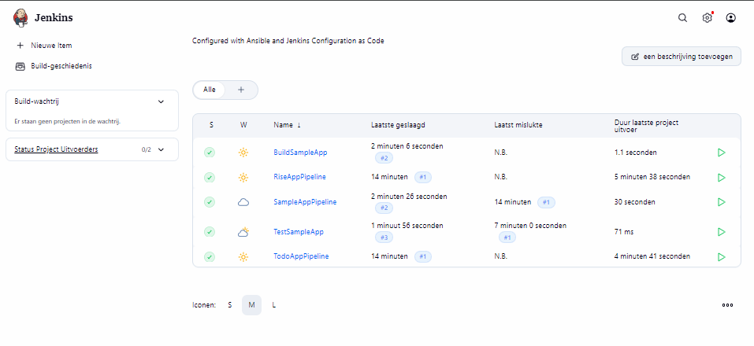

Controle:

```bash
docker exec risedb mariadb -urise_usr -pletmeinplz rise_db -e "SHOW TABLES;"
docker exec risedb mariadb -urise_usr -pletmeinplz rise_db -e "SELECT Email FROM Users;"
```

Resultaat: de tabellen `Product`, `Project`, `Roles`, `Technician`, `Users`, `__EFMigrationsHistory` en de ASP.NET Identity-tabellen, en de vijf testgebruikers (`admin@example.com`, `user@example.com`, `secretary@example.com` en twee technicians).

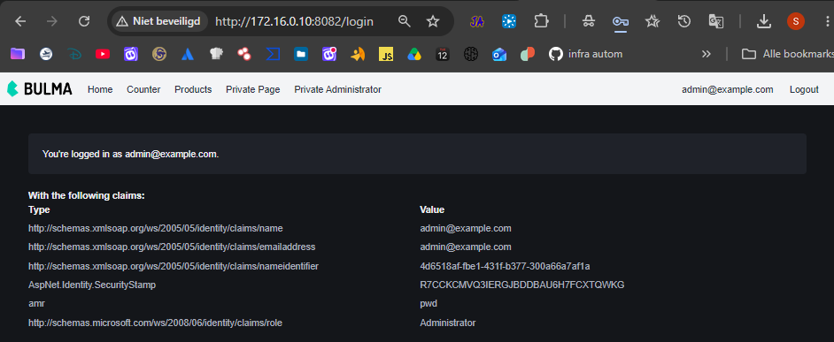

📸 De RISE-app in de browser, ingelogd als `admin@example.com`

### Fout 1: sleutel te lang

```
MySqlException: Specified key was too long; max key length is 3072 bytes
```

Oorzaak: sleutelkolommen waren `varchar(4000)`. Met `utf8mb4` is dat 16.000 bytes, en MariaDB staat maximaal 3072 toe. SQLite heeft die limiet niet.

Oplossing: string-sleutels beperkt tot 255 tekens in `OnModelCreating`.

### Fout 2: rij te groot

```
MySqlException: Row size too large. The maximum row size ... is 65535
```

Oorzaak: vier `varchar(4000)`-kolommen in `Users` samen zijn te groot voor één rij.

Oplossing: lange strings omgezet naar `longtext`.

Na elke wijziging aan het model: migrations opnieuw maken en het volume wissen (`docker volume rm rise-db-data`), want MariaDB draait een half aangemaakte database niet terug.

### Fout 3: inloggen en registreren mislukten in de browser

```
An unknown error prevented registration from succeeding.
```

Oorzaak: de Blazor-client draait in de browser en had `BackendUrl` op `https://localhost:5001`. Dat wijst naar mijn eigen pc, niet naar de VM. De serverlog toonde geen fouten, want de aanvragen kwamen nooit aan.

Onderzoek: de API met `curl` getest vanuit de VM (`200 OK`, gebruiker stond in MariaDB).

Oplossing: `BackendUrl` en `FrontendUrl` aangepast naar `http://172.16.0.10:8082` en Ctrl + F5 (Blazor bewaart dit bestand in de cache).

---

## 13. Uitbreiding: automatisch deployen bij een push

Een webhook van GitHub kan niet, want 172.16.0.10 is een privéadres dat GitHub niet bereikt. Daarom vraagt Jenkins elke minuut aan GitHub of er iets nieuws is (*Poll SCM*). Bovenaan het Jenkinsfile:

```groovy
properties([
    disableConcurrentBuilds(),
    pipelineTriggers([pollSCM("* * * * *")])
])
```

Eén keer handmatig **Build Now** (Jenkins leest de trigger pas tijdens een run), daarna nooit meer.

Demo:

```bash
echo "Demo continuous deployment" >> README.md
git add .
git commit -m "Demo: automatic deployment"
git push origin main
```

Binnen een minuut start er vanzelf een run. Bovenaan de Console Output staat `Started by an SCM change`.

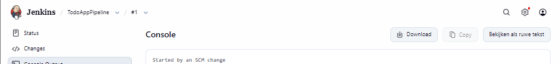

### Fout: twee builds tegelijk

```
docker: Error response from daemon: Conflict. The container name "/riseapp" is already in use
```

Oorzaak: twee pushes vlak na elkaar gaven twee parallelle builds (`RiseAppPipeline` en `RiseAppPipeline@2`), die dezelfde containernaam wilden.

Oplossing: `disableConcurrentBuilds()`, zodat builds na elkaar draaien.

Beperking: de app is tijdens een build enkele minuten niet bereikbaar. In een echte omgeving gebruik je meerdere instanties achter een loadbalancer.

---

## 14. Uitbreiding: Jenkins persistent met Ansible

Doel: na `vagrant destroy` en `vagrant up` staat Jenkins er weer, met dezelfde gebruiker en alle jobs, zonder handwerk.

`control.sh` voert bij `vagrant up` het playbook `site.yml` uit, dat de rol `dockerhost` (Docker en Portainer) bevat. Ik heb een rol `jenkins` toegevoegd. Het volume `jenkins-data` verdwijnt bij een destroy, dus de bron van de configuratie is de code in Git.

```
ansible/roles/jenkins/
├── defaults/main.yml        wachtwoord, namen
├── files/Dockerfile         Jenkins-image met plugins, zonder installatiewizard
├── files/casc/jenkins.yaml  admin-gebruiker (Jenkins Configuration as Code)
├── files/casc/jobs.groovy   alle jobs en pipelines
├── handlers/main.yml        Jenkins herstarten bij een wijziging
└── tasks/main.yml           image bouwen en container starten
```

`site.yml`:

```yaml
- name: "Configure infra010"
  hosts: infra010
  roles:
    - dockerhost
    - jenkins
```

De taken kopiëren de bestanden naar `infra010`, bouwen het image `jenkins-lab` en starten `jenkins_server` met dezelfde opties als in opgave 1.3 (poort 8080, Docker-socket, `jenkins-data`), plus de JCasC-map.

`TestSampleApp` zoekt de IP-adressen dynamisch op met `docker inspect`. In de opgave staan ze vast, maar na een destroy kunnen ze anders zijn.

Testen zonder destroy:

```bash
docker rm -f jenkins_server && docker volume rm jenkins-data
```

```bash
cd /vagrant/ansible
ansible-playbook -i inventory.yml site.yml --tags jenkins
```

Resultaat: `ok=6 changed=0 unreachable=0 failed=0`. Een tweede keer uitvoeren geeft dezelfde uitkomst (idempotent).

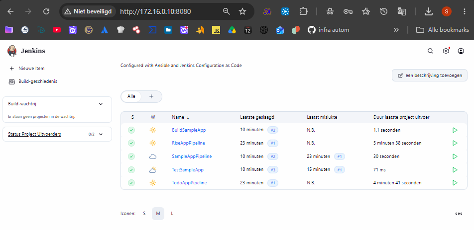

Eindtest op de host:

```powershell
vagrant destroy -f
vagrant up
```

Na `vagrant up` stonden Jenkins, de gebruiker `admin` en alle jobs er weer, zonder handwerk. De pipelines startten vanzelf (`Started by an SCM change`).

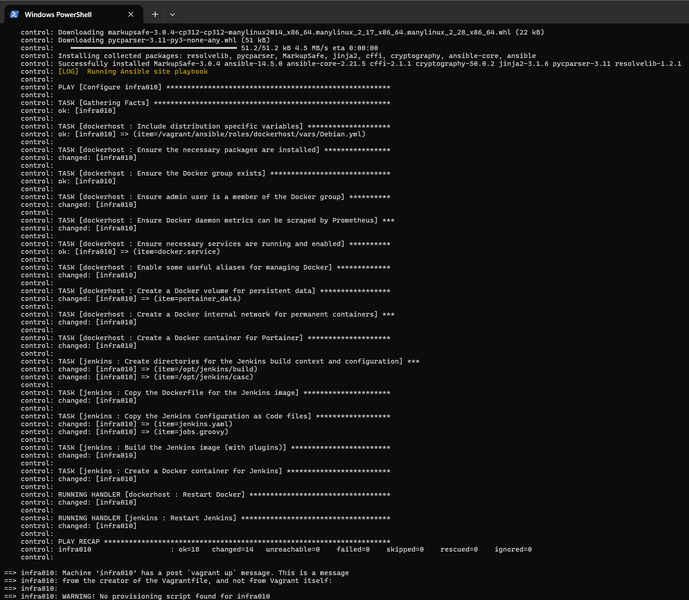

📸 Het dashboard na de eindtest

### Fout: TestSampleApp faalde na de eindtest

```
+ JENKINS_IP=172.17.0.2172.18.0.2172.19.0.2
+ grep You are calling me from 172.17.0.2172.18.0.2172.19.0.2
```

Oorzaak: `jenkins_server` zit op drie netwerken (`bridge`, `rise-net`, `todo-net`), omdat de Jenkinsfiles van de .Net-apps hem aan extra netwerken toevoegen. `docker inspect` met `range` plakte alle IP's aan elkaar.

Oplossing: enkel het IP op het netwerk `bridge` opvragen, in `jobs.groovy`:

```bash
docker inspect -f '{{.NetworkSettings.Networks.bridge.IPAddress}}' jenkins_server
```

Daarna de rol opnieuw uitgevoerd. De melding `No such container: samplerunning` in de stage *Preparation* is geen fout: `catchError` vangt die op.

Beperkingen:

- Het wachtwoord staat in `defaults/main.yml`. In de praktijk gebruik je `ansible-vault`.
- Buildgeschiedenis en databasegegevens gaan verloren bij een destroy. Alleen de configuratie wordt gereproduceerd.

---

## 15. Uitbreiding: lokale Git-server met GitLab

Jenkins haalt de broncode hier van een GitLab-container op de VM in plaats van van GitHub.

```bash
docker run -d \
  --hostname gitlab.local \
  --publish 8929:80 \
  --publish 2222:22 \
  --name gitlab \
  --restart always \
  gitlab/gitlab-ce:latest
```

Na het opstarten een project `cicd-sample-app` aangemaakt in GitLab en de bestaande repo daarheen gepusht:

```bash
git remote add origin http://root@172.16.0.10:8929/root/cicd-sample-app.git
git push -u origin main
```

Daarna in Jenkins de GitHub-URL vervangen door de GitLab-repository.


### Automatische build na een push

De GitLab Plugin is geïnstalleerd in Jenkins. In GitLab (*Settings* → *Webhooks*) staat een webhook met trigger *Push events*:

```text
http://172.16.0.10:8080/project/SampleAppPipeline
```

Bij een push stuurt GitLab direct een request naar Jenkins, en de pipeline start zonder **Build Now**. Dit is het verschil met sectie 13: GitLab draait op dezelfde VM, dus de webhook kan Jenkins wel bereiken en polling is niet nodig.

```bash
git add .
git commit -m "Webhook test"
git push
```

Resultaat: de code komt op de lokale GitLab, de webhook activeert Jenkins, en de app wordt opnieuw gebouwd en gedeployed.


### Fout: webhook geweigerd

```text
HTTP 403: anonymous is missing the Job/Build permission
```

Oorzaak: Jenkins liet anonieme webhook-aanvragen niet toe.

Oplossing: de Jenkins-beveiliging aangepast zodat de webhook de pipeline mag starten.

📋 Noteer hier welke instelling je precies aanpaste

Beperking: de GitLab-container is niet opgenomen in de Ansible-rol, dus na een `vagrant destroy` is hij weg.

---

## 16. Wat ik geleerd heb

- Een script moet herhaalbaar zijn (idempotent), anders faalt de tweede build.
- Een Jenkinsfile staat als code in Git bij de applicatie, een Freestyle-job niet.
- Een databaseprovider wisselen is meer dan een pakket vervangen: elke database heeft eigen limieten en de migrations zijn provider-specifiek.
- Met Ansible en Jenkins Configuration as Code staat de volledige Jenkins-installatie als code, zodat ze na een destroy opnieuw wordt uitgerold.
- Een push kan een deployment starten, via polling (GitHub, privénetwerk) of een webhook (lokale GitLab).

## Resources

- cursus materiaal (slides, handleiding)
- claude ai - voor info en hulp bij troubleshooting + layout voor verslag + vertalen verslag

